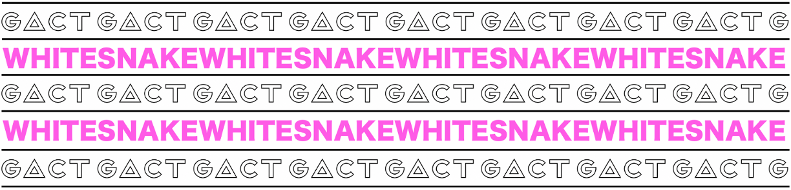
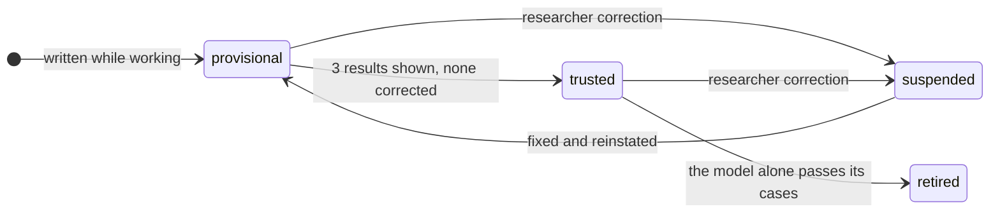

# WhiteSnake

**Deliver the process, not the software.** WhiteSnake lets a coding agent learn a task from the person doing it and write the software for that task while the work is being done. What remains is everything another person or agent needs to inherit the work: every result, the evidence and the rule behind it, the prompt that caused it, and the procedures the agent built along the way.

Under the hood a project is a **store**: plain Markdown files in git, validated and indexed by the `whitesnake` CLI, and driven through Claude Code or Codex with a shared skill and a shared set of hooks.

## Why

Coding agents such as Claude Code and Codex have become the entry point for research and automation work. The habit, though, is still to end a project by wrapping it in traditional software: a deterministic part, a few LLM calls for the interpretive steps, and a GUI, CLI or MCP server on top. That freezes assumptions that were still provisional, and it throws away most of what was learned on the way: the criteria agreed with the researcher, the attempts that failed, the exceptions found, the small scripts written to settle a doubt.

The agent can already do most of that work by writing code on the fly. What it lacks is memory: why each decision was taken, from which evidence, under which rule. WhiteSnake supplies that memory as a versioned store, so what you hand over is a process: the knowledge, the decisions, the procedures, and an agent that knows how to use them. A handoff succeeds when someone in a clean environment, without the original conversation, can explain a result picked at random, re-run an analysis, change a criterion and see exactly which results it affects, and complete a new case.

## How we see future systems

- **The interface is a coding agent.** You reach a system by talking to its agent. CLIs and APIs are still there, but their user is the agent. Instead of an orchestrator calling tools over MCP, a harness calls other harnesses, each able to pursue a goal, choose its tools and deal with exceptions.
- **Every system has learned from someone.** The agent of a project carries what it learned from the people who worked with it, and when it meets a gap it writes the missing code itself.
- **Reasoning turns into procedure.** Where the agent can do a task, the system calls the agent. Once its way of doing something has proved right, that way becomes a procedure, so reasoning is spent only where uncertainty remains.
- **Systems grow fractally.** Nodes delegate to nodes, and at every level the gaps are covered a little at a time, without anyone designing the whole system up front.

## Software written while doing the work

You don't build the tool first and use it afterwards. You work on the actual task with the agent, and the software accumulates as a by-product:

- The agent records each step through the CLI as it works: the evidence it read (verbatim, with an exact locator), the decision it took and the criterion that licenses it, the episode it belonged to and the prompt that caused it.
- A command that solved a step runs through `whitesnake run`, which records it with its inputs and output. When the same step recurs, `whitesnake procedure propose` turns the recorded executions into a procedure with one regression case per execution. Code the agent writes to fill a gap is saved under `procedures/` and registered as a provisional procedure.
- The researcher teaches by working normally. A rule they state becomes a criterion that later values cite as their warrant. A correction (`whitesnake correct`) marks the wrong value, suspends the procedures behind it and flags everything that relied on it. Results they saw without objecting count as accepted.

What the agent learns from the user about a task therefore lives in files under git, not in a session or in a model. It survives the end of the session, a change of model and a change of person.

## Procedure promotion

A procedure is a reusable way of doing one step: a script, a frozen prompt (prompt, pinned model and output schema) or a skill. It starts provisional and earns trust from use. Nobody sets its state by hand; the CLI derives it from recorded events.



Before working on a value, the agent checks a ladder (`whitesnake resolve`): an accepted result for the same question, then a trusted procedure, and only then its own reasoning. When every child of an episode has been resolved without the agent, `whitesnake collapse` merges them into one composed procedure and the agent call moves one level up. The share of work resolved without an agent is the store's main indicator.

Procedures are perishable; knowledge is durable. When a new model can reproduce a procedure's regression cases on its own, the procedure is retired (sublation) and its past outputs stand. The reason to converge on deterministic procedures is reproducibility, auditability and a stable interface, not making up for what the model cannot do yet.

## Nodes that write themselves

The unit of work has the same shape at every scale. Inside a store it is an episode: a question, the prompt that caused it, how it was resolved, what it used, what it produced and its child episodes. Between stores it is the store itself: seen from its parent, a child store is one more episode whose children are remote.

Each store is a node with its own git repository, mandate, agent, records and procedures, and each node writes itself: its agent fills its own gaps with code, registers its own procedures and promotes or retires them from its own history. A parent delegates a question together with the reason it matters (`whitesnake delegate`). The child works on a branch reserved for that parent, where it may modify itself, and answers with its result, the ids of the decisions and evidence behind it, its uncertainties and any new questions, rather than a bare summary. Evidence merges by itself; conflicting decisions, criteria or procedures are listed for explicit reconciliation.

## Status

Research prototype. The store, the procedure lifecycle, handoff, delegation and compaction are implemented. They pass the deterministic tests and live tests with both Claude Code and Codex on the toy store in `examples/`, but have not yet been used on a real corpus. Nodes are directories on one machine, invoked headless; there is no network transport yet.

The design decisions and their rationale are in [DESIGN.md](DESIGN.md) (Italian). The original design conversation is in `docs/origine/`.

## Layout

- `src/` TypeScript sources of the CLI (`whitesnake`): record schemas, store validator, SQLite index, provenance queries, harness log ingest, hook runner.
- `skill/whitesnake/` the skill that teaches an agent how to work inside a store (same file for Claude Code and Codex).
- `hooks/templates/` hook settings installed into a store by `whitesnake init`.
- `examples/toy-store/` a small, valid store generated from `examples/toy-corpus/` by `npm run make-toy`; fixture for tests and for the live acceptance test. P01 is annotated as a precedent; P02 is straightforward; P03 reports both ITT and per-protocol counts and contains a deliberate disagreement between prose and table, so an agent must apply the store's criteria and record the conflict.
- `test/` deterministic tests (`node:test`) with goldens in `test/fixtures/toy-golden/`.
- `bin/whitesnake` launcher so the CLI works from `PATH` without a global install.

A **store** is a separate directory (and git repository) created with `whitesnake init <dir> --id <id> ...`. It contains `whitesnake.yaml` (mandate, output fields), `knowledge/<type>/<id>.md` records, `corpus/`, `procedures/`, `artifacts/`, `output/` (derived), and `.whitesnake/` (index, hook log, current turn; not versioned).

## Requirements

Node 22.13 or newer (tested on 23.10), git. For the live test: the `claude` CLI. No native dependencies.

## Build and test

```
npm install
npm test            # build + deterministic tests
npm run make-toy    # regenerate examples/toy-store
```

Add `bin/` to your `PATH` (or `npm link`) to call `whitesnake` directly.

## Live acceptance test (M1)

```
npm run e2e:m1 -- --smoke          # checks that hooks fire in a headless Claude Code session
npm run e2e:m1 -- --runs 3         # a real session annotates P02 and P03 in a fresh copy of the toy store
```

A run passes when the store validates, every annotated cell has a complete provenance chain (evidence with resolvable locator, criterion as warrant, prompt of this session as `caused_by`), the index rebuild is byte-identical, changing the ITT criterion marks exactly the `n_analyzed_total` annotations as affected, every hook fired without errors, and the agent's first access to the store went through the CLI rather than reading `knowledge/` files.

## Codex

The same store works with Codex: `whitesnake init` writes `.codex/hooks.json` (same events as the Claude Code hooks) and links the skill into `.agents/skills/`. Codex runs project hooks only after you trust them with `/hooks`, or for one invocation with `codex exec --dangerously-bypass-hook-trust`, which the live test uses. If your `~/.codex/config.toml` selects a model newer than the installed CLI accepts, pass a supported one: `npm run e2e:m1 -- --harness codex --model gpt-5.6-sol`.

## Lifecycle of procedures and decisions

States are never edited by hand; the CLI derives them from recorded events and the validator cross-checks the cached state against the history.

- `whitesnake episode open|close` brackets a unit of work; a decision's `produced_by` must be a leaf episode listing in `uses` only what it applied.
- `whitesnake shown <ids>` records that decisions were presented to the researcher (the Stop hook also scans the agent's final message for decision ids). The first time a decision is shown, each procedure its episode used earns a shown use; at `promotion.shown_uses_to_trust` uses without a correction (default 3) a provisional procedure becomes trusted.
- `whitesnake correct <id> --reason ... [--value v]` records a researcher correction: the decision is marked `needs_review` (or superseded by a new one when a value is given), the episode becomes `corrected`, the procedures it used are suspended, and everything that relied on the decision is marked `needs_review`.
- `whitesnake resolve --unit U --field F` applies the resolution ladder: an accepted decision, a trusted procedure, or agent work.
- `whitesnake kpi` and `whitesnake render` (writes `review.html`) show how the store is doing: episodes resolved without an agent, decisions by status and whether they were shown, procedure transitions per session, items to review, the timeline by prompt, and recording warnings.

## Commands versus code

An agent that solves a step with a terminal command is not forced to write software. `whitesnake run "<command>" --episode <id>` executes the command and records it as execution evidence (command, exit code, platform, hashes of the input files, output). When the same command recurs across episodes, `whitesnake procedure propose --from-evidence <ids>` distils the recorded executions into a procedure skeleton with one regression case per execution; shown uses then promote it like any procedure. On another machine, `whitesnake check` (also run automatically at the first open of an imported store) re-runs the regression cases of code procedures and suspends those that no longer reproduce, with the platform in the reason: the agent falls back to doing the step itself and may supersede them with an adapted version. Past outputs always stand.

## Handoff, branches and delegation

- `whitesnake export <dir> [--no-history]` clones the store for handoff with a `manifest.json` (integrity hashes of every record, artifacts present or excluded, whether git history is included), the rendered review page and the derived output. `whitesnake check` on the imported copy verifies the manifest, the artifacts, the records and rebuilds the index.
- `whitesnake branch open --parent <id>` gives a parent store its own branch `parent/<id>` and worktree in a child store, rebased on main; `branch status` and `branch merge <id>` reconcile explicitly. Evidence merges by itself; a conflict on decisions, criteria or procedures aborts and is listed, leaving main untouched.
- `whitesnake delegate --child <dir|id> --question "..." [--why ...] [--harness claude|codex]` runs the child store's agent on this store's branch with a structured task and records the answer here as execution evidence plus an episode whose child is a remote reference. `whitesnake ask "<question>"` answers a question about the store from CLI queries, citing record ids.
- `whitesnake gate` compares the CLI surface with the committed `contract.json`: additive changes pass, removals and renames fail. Run `gate --snapshot` when a breaking change is intended and versioned.

## Compaction, collapse and sublation

- `whitesnake gc [--apply] [--cold-after N]` compacts closed, cold episode subtrees that nothing live depends on into `template` nodes (summary, locators, negative examples, the ids replaced and the commit that still holds the raw files) and removes them from the working tree. Live provenance never changes; git history keeps the raw records; a second apply is a no-op.
- `whitesnake collapse <episode>` turns a parent episode whose children were all resolved without an agent into one composed procedure (a step list reusing the children's procedures). The agent call moves one level up.
- `whitesnake procedure recheck <id> --harness claude|codex [--model M] [--retire]` is the sublation check: the model alone, without the procedure's code, must reproduce every regression case. When it does and `--retire` is given, the procedure is retired; its past outputs stand.

## CLI

`whitesnake --help` lists every command. The ones an agent uses most: `precedent`, `frontier`, `why`, `affected`, `add`, `set`, `link`, `shown`, `validate`. See `skill/whitesnake/references/cli-cheatsheet.md`.

## License

MIT.
