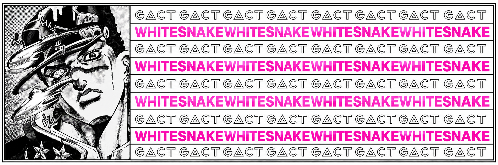
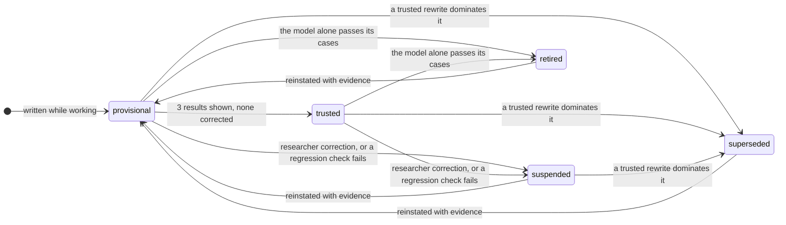

<p align="center">
  
</p>
<h1 align="center">WhiteSnake</h1>
<h3 align="center">Fractal network of agents learning from users</h3>

<p align="center">
  <a href="LICENSE"></a>
  
  
  
</p>

<p align="center">
  <a href="#why">Why</a> ·
  <a href="#how-we-see-future-systems">Future systems</a> ·
  <a href="#generalization-at-scale-an-open-question">Generalization</a> ·
  <a href="#critical-review">Critical review</a> ·
  <a href="#procedure-promotion">Procedures</a> ·
  <a href="#rewriting-a-procedure">Rewrites</a> ·
  <a href="#the-cli-can-be-sublated-too">Sublation</a> ·
  <a href="#nodes-that-write-themselves">Nodes</a> ·
  <a href="#build-and-test">Build</a> ·
  <a href="DESIGN.md">Design</a>
</p>

**Deliver the process, not the software.** WhiteSnake lets a coding agent learn a task from the person doing it and write the software for that task while the work is being done. What remains is everything another person or agent needs to inherit the work: every result, the evidence and the rule behind it, the prompt that caused it, and the procedures the agent built along the way.

Under the hood a project is a **store**: plain Markdown files in git, validated and indexed by the `whitesnake` CLI, and driven through Claude Code or Codex with a shared skill and a shared set of hooks.

## Why

Coding agents such as Claude Code and Codex have become the entry point for research and automation work. The habit, though, is still to end a project by wrapping it in traditional software: a deterministic part, a few LLM calls for the interpretive steps, and a GUI, CLI or MCP server on top. That freezes assumptions that were still provisional, and it throws away most of what was learned on the way: the criteria agreed with the researcher, the attempts that failed, the exceptions found, the small scripts written to settle a doubt.

The agent can already do most of that work by writing code on the fly. What it lacks is memory: why each decision was taken, from which evidence, under which rule. WhiteSnake supplies that memory as a versioned store, so what you hand over is a process: the knowledge, the decisions, the procedures, and an agent that knows how to use them. A handoff succeeds when someone in a clean environment, without the original conversation, can explain a result picked at random, re-run an analysis, change a criterion and see exactly which results it affects, and complete a new case.

## How we see future systems

- **The interface is a coding agent.** You reach a system by talking to its agent. CLIs and APIs are still there, but their user is the agent. Instead of an orchestrator calling tools over MCP, a harness calls other harnesses, each able to pursue a goal, choose its tools and deal with exceptions.
- **Every system has learned from someone.** The agent of a project carries what it learned from the people who worked with it, and when it meets a gap it writes the missing code itself.
- **Reasoning turns into procedure.** Where the agent can do a task, the system calls the agent. Once its way of doing something has proved right, that way becomes a procedure, so reasoning is spent only where uncertainty remains.
- **Systems grow fractally.** Nodes delegate to nodes, and at every level the gaps are covered a little at a time, without anyone designing the whole system up front.

## Software written while doing the work

You don't build the tool first and use it afterwards. You work on the actual task with the agent, and the software accumulates as a by-product:

- The agent records each step through the CLI as it works: the evidence it read (verbatim, with an exact locator), the decision it took and the criterion that licenses it, the episode it belonged to and the prompt that caused it.
- A command that solved a step runs through `whitesnake run`, which records it with its inputs and output. When the same step recurs, `whitesnake procedure propose` turns the recorded executions into a procedure with one regression case per execution. Code the agent writes to fill a gap is saved under `procedures/` and registered as a provisional procedure.
- The researcher teaches by working normally. A rule they state becomes a criterion that later values cite as their warrant. A correction (`whitesnake correct`) marks the wrong value, suspends the procedures behind it and flags everything that relied on it. Results they saw without objecting count as accepted.

What the agent learns from the user about a task therefore lives in files under git, not in a session or in a model. It survives the end of the session, a change of model and a change of person.

## Generalization at scale: an open question

> [!IMPORTANT]
> **Critical design question, still under discussion.** For a large annotation task, such as work on a database the size of CELLxGENE, asking an agent to prefer deterministic code does not establish that it will generalize enough to make the work affordable. WhiteSnake has not yet demonstrated this at scale.

An agent can write code for each individual case, or reuse a procedure while still making model calls to select, invoke and inspect it for every record. The working hypothesis is that it should actively discover families of cases, develop reusable rules from informative examples, validate them on separate cases and execute them in batches, returning to the model for grouped exceptions. Applicability, abstention and provenance must survive that generalization.

The [skill](skill/whitesnake/SKILL.md#generalization-for-large-annotation-tasks) now includes experimental guidance for this behaviour. Whether instructions are sufficient, which checks should be enforced by the runtime, and how much generalization is economically worthwhile remain open. The objective under discussion is total cost per correct result at the required quality and coverage. The current episode-based KPI does not measure actual model calls or spending, and prompt instructions do not enforce a hard budget.

See the [design discussion and proposed evaluation](DESIGN.md#h-open-discussion-generalization-and-cost-at-scale). This guidance is not evidence of an implemented optimization loop or validated savings.

## Critical review

The shared skill uses [Walton-inspired critical questions](skill/whitesnake/references/walton-checklist.md) at specific triggers: substantial work, weak or conflicting evidence, broader application of a rule, recurring failures or unexpected costs, and substantive completion claims. The agent consults existing decisions, performs relevant checks and records findings with evidence. A review can be reused across a batch within its stated scope.

The agent handles delegated implementation choices and involves the user when an unresolved choice about meaning, goals, acceptable error, coverage or resources changes the outcome. Prior answers remain in the store for reuse. This workflow is implemented as skill guidance; its effect on quality, cost and user interruptions remains to be evaluated. It adds no automatic budget or approval enforcement.

## Procedure promotion

A procedure is a reusable way of doing one step: a script, a frozen prompt (prompt, pinned model and output schema) or a skill. It starts provisional and earns trust from use. Nobody sets its state by hand: the CLI replays the recorded events, in time order, and the state, counters and history written in the record are a cache of that replay. The validator refuses a cache that disagrees with the events, and `whitesnake procedure recompute` rewrites it.



The implicit transitions come from two events recorded on decisions: a decision shown to the researcher (`shown_at`, with the turn and the moment) and a decision corrected (`corrections`, one identified event each). The explicit ones, reinstate, retire, supersede and the suspension a failed regression check applies, are `choice` decisions that name the procedure and cite their evidence. A correction moves a procedure's state only when its author owns the context it is made in: the store's researcher on main, the parent's researcher on the parent's branch; any other correction is counted by the scorecard and raises a question instead.

Before working on a value, the agent checks a ladder (`whitesnake resolve`): an accepted result for the same question, then a trusted procedure, and only then its own reasoning. When every child of an episode has been resolved without the agent, `whitesnake collapse` merges them into one composed procedure and the agent call moves one level up. The share of work resolved without an agent is the store's main indicator.

Procedures are perishable; knowledge is durable. When a new model can reproduce a procedure's regression cases on its own, the procedure is retired (sublation) and its past outputs stand. The reason to converge on deterministic procedures is reproducibility, auditability and a stable interface, not making up for what the model cannot do yet.

## Rewriting a procedure

An agent that finds a procedure wanting does not edit it. **Code that produced a result never changes**: the record keeps the sha256 of the entrypoint, exactly as artifacts keep the hash of a source, and a file that differs makes the store invalid (`E_PROCEDURE_HASH`). Every recorded execution says which code version ran, so provenance keeps pointing at the code that produced each value. A change is a new procedure that names the one it replaces (`supersedes`) and says why, in a form the store can check (`justification`): the kind of reason, from a closed list, and the records that prove it. "Rewritten because it was slow" is prose; "rewritten because on P03 the old one took 4.1 s and the new 0.3 s on this machine, executions ev_111 and ev_112" is a justification. Correctness needs a correction or a failing case, performance two timings on the same inputs, scope new regression cases, platform a recorded check failure.

Whether the rewrite is better is not a judgement either. The old procedure carries its own test battery: its regression cases, plus every input it was run on together with what the researcher did with the value, accepted, corrected or never confirmed. `whitesnake procedure compare <old> <new>` replays all of it with the new code and judges each case against the record: `same`, `fixed`, `regression`, `still_wrong`, `diverge` where no accepted value exists. The rule is **never worse on a recorded case, better on at least one**. A rewrite that fixes one case and breaks another is not better, it is different, and the diverging cases go to the researcher. The report is recorded as execution evidence.

Until then the two coexist. The new one starts provisional, the agent runs both on new inputs, lists both in the episode's `uses` and shows one value, so agreements earn the newcomer shown uses with no extra work from the researcher, and disagreements become rebuttal evidence and a question. `whitesnake procedure supersede <new>` does the replacement when three things hold: the new procedure is trusted, it dominates on every recorded case, and it clears every threshold the researcher declared. It records a `choice` decision with the comparison as data, and the old procedure becomes `superseded`: out of the resolution ladder, its past outputs standing. Its record stays as long as any value points at it; `gc` later archives its code with the commit that keeps it.

Measurements are derived, thresholds are decided. `whitesnake procedure scorecard <id>` computes from the records how often a procedure was used, how many outputs were shown and corrected, the observed error rate (a lower bound: unobserved outputs tell nothing), the regression checks that failed, the latency per platform and machine, and whether several code versions ran under one record. A bar on those numbers is a criterion like any other rule: a `criterion` decision with a `threshold` ("zero corrections over at least twenty observed outputs"), applied by the CLI and reopened by `affected` when it changes. Without one, the dominance rule applies, and at equal results the faster procedure on the same machine wins.

## The CLI can be sublated too

**WhiteSnake's own infrastructure is subject to the same principle.** The CLI embodies procedures for recording decisions, tracing provenance, finding affected results and managing corrections. As models become capable of performing those operations reliably, individual commands—and potentially the CLI itself—may become unnecessary. An agent might reconstruct a provenance chain directly from records or write valid records without a dedicated command. The capability remains available even when its implementation is retired.

The lasting commitments are preserving evidence, making corrections traceable and allowing another person or agent to inherit the work. The command interface and the procedures that fulfil those commitments can evolve independently. A smaller deterministic validator may remain useful while other operations move to the agent; its continued use should also be justified by reliability, reproducibility and overall cost.

Retirement should follow demonstrated capability: the replacement must pass the relevant behavioural tests, including error cases, and preserve the handoff test. Passing examples alone does not establish the same guarantees as deterministic checks. The comparison must also account for the effort and context spent invoking commands and maintaining records. Removing infrastructure can be progress when the agent preserves the required behaviour at a lower overall cost.

At large volumes, a procedure may remain worth keeping even when the model can reproduce its results: replacing cheap repeated execution with model calls can increase total cost. Capability and economic benefit need separate evaluation.

This is a design principle for future evolution. In the current implementation, knowledge writes still go through the CLI and its validation and hook contracts.

## Nodes that write themselves

The unit of work has the same shape at every scale. Inside a store it is an episode: a question, the prompt that caused it, how it was resolved, what it used, what it produced and its child episodes. Between stores it is the store itself: seen from its parent, a child store is one more episode whose children are remote.

Each store is a node with its own git repository, mandate, agent, records and procedures, and each node writes itself: its agent fills its own gaps with code, registers its own procedures and promotes or retires them from its own history. A parent delegates a question together with the reason it matters (`whitesnake delegate`). The child works on a branch reserved for that parent, where it may modify itself, and answers with its result, the ids of the decisions and evidence behind it, its uncertainties and any new questions, rather than a bare summary. Evidence merges by itself; conflicting decisions, criteria or procedures are listed for explicit reconciliation.

## Status

> [!NOTE]
> **Research prototype.** The store, the procedure lifecycle, handoff, delegation and compaction are implemented. They pass the deterministic tests and live tests with both Claude Code and Codex on the toy store in `examples/`, but have not yet been used on a real corpus. Nodes are directories on one machine, invoked headless; there is no network transport yet.

The design decisions and their rationale are in [DESIGN.md](DESIGN.md). The original design conversation is in `docs/origin/`.

## Layout

- `src/` TypeScript sources of the CLI (`whitesnake`): record schemas, store validator, SQLite index, provenance queries, harness log ingest, hook runner.
- `skill/whitesnake/` the skill that teaches an agent how to work inside a store (same file for Claude Code and Codex).
- `hooks/templates/` hook settings installed into a store by `whitesnake init`.
- `examples/toy-store/` a small, valid store generated from `examples/toy-corpus/` by `npm run make-toy`; fixture for tests and for the live acceptance test. P01 is annotated as a precedent; P02 is straightforward; P03 reports both ITT and per-protocol counts and contains a deliberate disagreement between prose and table, so an agent must apply the store's criteria and record the conflict.
- `test/` deterministic tests (`node:test`) with goldens in `test/fixtures/toy-golden/`.
- `bin/whitesnake` launcher so the CLI works from `PATH` without a global install.

A **store** is a separate directory (and git repository) created with `whitesnake init <dir> --id <id> ...`. It contains `whitesnake.yaml` (mandate, output fields), `knowledge/<type>/<id>.md` records, `corpus/`, `procedures/`, `artifacts/`, `output/` (derived), and `.whitesnake/` (index, hook log, current turn; not versioned).

## Requirements

Node 22.13 or newer (tested on 23.10), git. For the live test: the `claude` CLI. No native dependencies.

## Build and test

```
npm install
npm test            # build + deterministic tests
npm run make-toy    # regenerate examples/toy-store
```

Add `bin/` to your `PATH` (or `npm link`) to call `whitesnake` directly.

The same suite runs in GitHub Actions on every push, on Ubuntu and macOS with Node 22.13 and 24 (`.github/workflows/test.yml`), followed by `gate` against the committed contract. The live tests below are not part of it.

## Live acceptance test (M1)

```
npm run e2e:m1 -- --smoke          # checks that hooks fire in a headless Claude Code session
npm run e2e:m1 -- --runs 3         # a real session annotates P02 and P03 in a fresh copy of the toy store
```

A run passes when the store validates, every annotated cell has a complete provenance chain (evidence with resolvable locator, criterion as warrant, prompt of this session as `caused_by`), the index rebuild is byte-identical, changing the ITT criterion marks exactly the `n_analyzed_total` annotations as affected, every hook fired without errors, the agent's first access to the store went through the CLI rather than reading `knowledge/` files, and no file under `knowledge/` changed outside the CLI. The last point is checked by result, not by inspecting commands: the CLI journals every file it writes under `knowledge/`, and at every Stop the hook compares the tree with the snapshot of the previous check.

## Codex

The same store works with Codex: `whitesnake init` writes `.codex/hooks.json` (same events as the Claude Code hooks) and links the skill into `.agents/skills/`. Codex runs project hooks only after you trust them with `/hooks`, or for one invocation with `codex exec --dangerously-bypass-hook-trust`, which the live test uses. If your `~/.codex/config.toml` selects a model newer than the installed CLI accepts, pass a supported one: `npm run e2e:m1 -- --harness codex --model gpt-5.6-sol`.

## Lifecycle of procedures and decisions

States are never edited by hand; the CLI derives them from recorded events and the validator cross-checks the cached state against the history.

- `whitesnake episode open|close` brackets a unit of work; a decision's `produced_by` must be a leaf episode listing in `uses` only what it applied.
- `whitesnake shown <ids>` records that decisions were presented to the researcher (the Stop hook also scans the agent's final message for decision ids). The first time a decision is shown, each procedure its episode used derives a shown use; at `promotion.shown_uses_to_trust` uses without a correction (default 3) a provisional procedure becomes trusted. `shown` needs the turn it happened in (the current turn, or `--turn`): it is a recorded event with its moment, so repeating it changes nothing. A procedure's `state`, `counters` and `history` are a cache of the replay of these events; the validator checks the cache against the replay (`E_STATE_MISMATCH`, `E_COUNTER_MISMATCH`, `E_HISTORY_MISMATCH`).
- `whitesnake correct <id> --reason ... [--value v]` records a researcher correction as an identified event on the decision: the decision is marked `needs_review` (or superseded by a new one when a value is given), the episode becomes `corrected`, the procedures it used derive their suspension from the event, and everything that relied on the decision is marked `needs_review`. A correction is identified by its decision and turn (or by `--event`): applied again, it writes nothing. A cell holds one active annotation, and the validator refuses a second one (`E_DUPLICATE_ACTIVE`).
- `whitesnake procedure reinstate <id> --reason ... --evidence <ids...>`, `whitesnake procedure retire <id> --reason ... [--evidence ...]` and `whitesnake procedure supersede` record explicit transitions as `choice` decisions that name the procedure (`transition`, `depends_on`) and cite their evidence. `whitesnake procedure recompute [ids...]` rewrites the cached state from the events; `branch open` and `branch merge` do the same after a rebase or a merge, so two branches that used the same procedure never fight over a counter.
- `whitesnake resolve --unit U --field F` applies the resolution ladder: an accepted decision, a trusted procedure, or agent work. A decision under review after a correction is never offered for reuse: `resolve` answers `review` and asks for the value to be redone and superseded. When a live procedure lists a live one in `supersedes`, the answer also says how to run the two side by side.
- `whitesnake procedure compare <old> <new>` replays the old procedure's recorded battery with the new code and records the verdicts; `whitesnake procedure supersede <new>` replaces the old one when the new is trusted, dominates and clears the declared thresholds; `whitesnake procedure scorecard <id>` derives the measurements; `whitesnake procedure rehash <id>` re-registers the code hash, only while nothing has used the procedure.
- `whitesnake kpi` and `whitesnake render` (writes `review.html`) show how the store is doing: episodes resolved without an agent, decisions by status and whether they were shown, procedure transitions per session, items to review, the timeline by prompt, and recording warnings.

## Commands versus code

An agent that solves a step with a terminal command is not forced to write software. `whitesnake run "<command>" --episode <id>` executes the command and records it as execution evidence (command, exit code, platform, hashes of the input files, output). When the same command recurs across episodes, `whitesnake procedure propose --from-evidence <ids>` distils the recorded executions into a procedure skeleton with one regression case per execution; shown uses then promote it like any procedure. On another machine, `whitesnake check` (also run automatically at the first open of an imported store) re-runs the regression cases of code procedures and suspends those that no longer reproduce, with the platform in the reason: the agent falls back to doing the step itself and may register an adapted version that supersedes them (see [Rewriting a procedure](#rewriting-a-procedure)). Past outputs always stand. Every registered procedure carries the sha256 of its entrypoint, and every execution records the hash of the script it ran and a short hash of the host, so a value can always be traced to the exact code and machine that produced it.

## Where memory goes

Gaps are covered by the coding agent working in a store, never by a human or a rigid fallback. The knowledge produced belongs to the store that owns the domain of the gap: the child that provides the service, not the parent that calls it. The parent keeps the returned result and stable references as evidence of the exchange. When the parent's agent nevertheless has to write into a child (delegation impossible, ownership blurry), running `whitesnake --store <child> ...` from inside the parent works on the child's `parent/<parent-id>` branch, mirrors the parent's session and turn into the child so provenance resolves locally, and attributes the records to the parent's agent. The child's main changes only through reconciliation.

## Handoff, branches and delegation

- `whitesnake export <dir> [--no-history]` clones the store for handoff with a `manifest.json` (integrity hashes of every record, artifacts present or excluded, whether git history is included), the rendered review page and the derived output. `whitesnake check` on the imported copy verifies the manifest, the artifacts, the records and rebuilds the index. Artifacts are compared with the sha256 registered when they were added, by `validate` (trusting a size and mtime cache; `--full` re-reads) and by `check` (always re-reading): a source that changed since registration is an error, because every locator into it is suspect.
- `whitesnake branch open --parent <id>` gives a parent store its own branch `parent/<id>` and worktree in a child store, rebased on main; `branch status` and `branch merge <id>` reconcile explicitly. Evidence merges by itself; a conflict confined to a procedure's derived cache is resolved by deriving it again from the events of both sides; any other conflict on decisions, criteria or procedures aborts and is listed, leaving main untouched. The merged tree is validated before it is committed.
- `whitesnake delegate --child <dir|id> --question "..." [--why ...] [--harness claude|codex]` runs the child store's agent on this store's branch with a structured task and records the answer here as execution evidence plus an episode whose child is a remote reference. `whitesnake ask "<question>"` answers a question about the store from CLI queries, citing record ids.
- `whitesnake gate` compares the CLI surface with the committed `contract.json`: additive changes pass, removals and renames fail. Run `gate --snapshot` when a breaking change is intended and versioned.

## Compaction, collapse and sublation

- `whitesnake gc [--apply] [--cold-after N]` compacts closed, cold episode subtrees that nothing live depends on into `template` nodes (summary, locators, negative examples, the ids replaced and the commit that still holds the raw files) and removes them from the working tree. Live provenance never changes; git history keeps the raw records; a second apply is a no-op. `--apply` requires git and commits the working tree first, so the commit recorded in the template contains every raw record it replaces. The same pass archives the code of superseded and retired procedures once it is cold: the file (or its directory, when no other procedure lives there) leaves the working tree and the record keeps the commit that holds it. The record itself is never removed, because every value produced with it still points there.
- `whitesnake collapse <episode>` turns a parent episode whose children were all resolved without an agent into one composed procedure (a step list reusing the children's procedures). The agent call moves one level up.
- `whitesnake procedure recheck <id> --harness claude|codex [--model M] [--retire]` is the sublation check: the model alone, without the procedure's code, must reproduce every regression case. When it does and `--retire` is given, the procedure is retired; its past outputs stand.

## CLI

`whitesnake --help` lists every command. The ones an agent uses most: `precedent`, `frontier`, `why`, `affected`, `add`, `set`, `link`, `shown`, `validate`. See `skill/whitesnake/references/cli-cheatsheet.md`.

## License

MIT.
