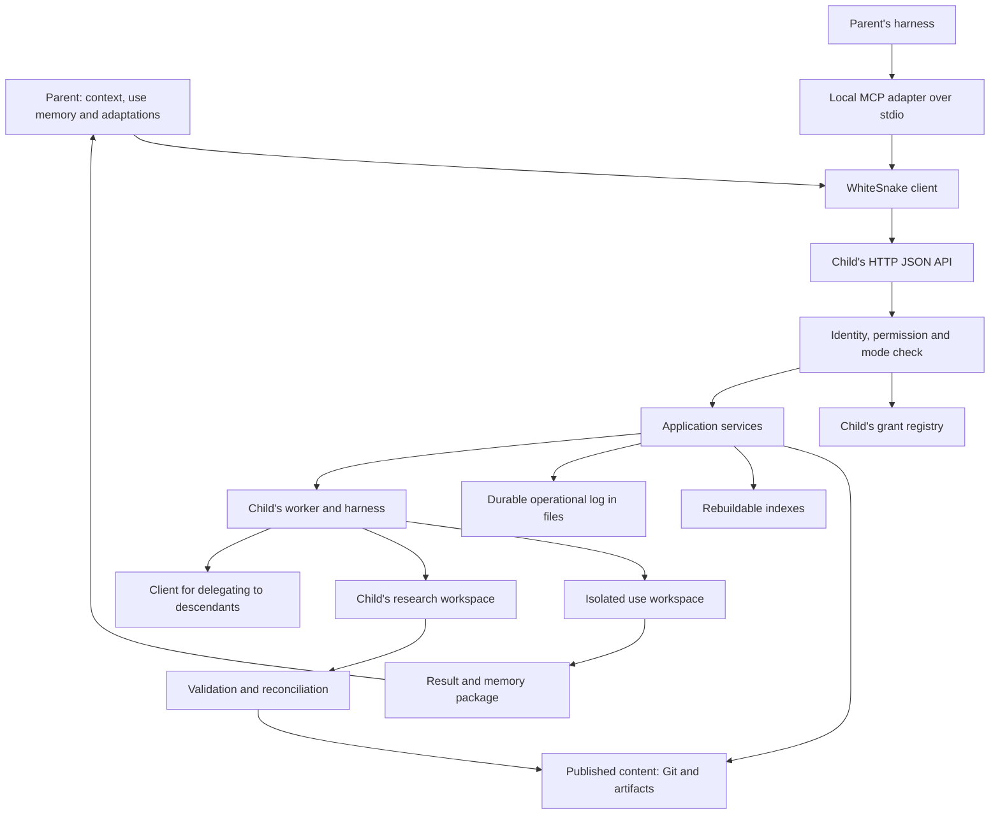

**WhiteSnake — development plan for executable, searchable and reusable nodes**

**Historical document, superseded by the [WhiteSnake 2.0 guides](v2/README.md).** The text below preserves the plan on baseline `4e057be`. For the verified state of the new implementation see [status](v2/status.md) and [review](v2/implementation-review.md). The later decision on the [parent–child relationship](v2/parent-child.md) specifies that `use` code is executed and maintained in a persistent sandbox in the child; the parent keeps scientific memory and acquired snapshots. The passages below that treat the child's workspace as a cache that can be deleted after the receipt are no longer the current choice.

Updated: 6 November 2026. Verified code baseline: `4e057be`. Status: plan updated after the discussion, including ownership of code in `use` and authorization of `research` by the child; new structures, commands and APIs are still to be implemented. The deterministic suite had been run during the conversation on the same baseline: 64 tests passed. This update changes only the plan. The historical live tests concern the toy store; Linux compatibility, the distributed network and efficiency on real data still have to be verified.

The researcher installs WhiteSnake, initializes a store and works through a harness. The code, criteria, decisions, rationales, findings and checks that accumulate make the node progressively more reusable and validated in the areas actually tested. The store becomes reachable by other nodes, which can consult it, reuse its components or assign it a task. The parent can act either as a user or as a researcher of the child.

This revision incorporates the decisions on communication, interoperability, indexing, reconciliation, validation and memory ownership. The `use` and `research` modes are part of the task contract from the first remote delegation. Usage memory belongs to the parent; research meant to improve the child is recorded in the child and published according to its rules.

**Starting point and verified limits.**

| Area | Current state | Work needed |
|---|---|---|
| Store and knowledge | Markdown/Git, schemas, validation, SQLite index, provenance, local corrections, procedures and lifecycle. | Separate shared memory from the memory of usage contexts; version remote references. |
| Registry | `stores` maps aliases to local directories. | Stable UIDs, local/remote endpoints, permissions and recursive registrations. |
| Delegation | Synchronous runner; tasks and outputs in `.whitesnake/tasks`, ignored by Git; acquisition in the parent once execution has finished. | Durable submission, worker, recovery, delivery and receipts; transfer of `use` memory. |
| Branches | `parent/<id>` worktree; rebase on opening; explicit merge with an immediate commit, without semantic reconciliation. | UIDs instead of aliases; distinguish `use` workspaces from `research` contributions; verified publication. |
| Resolution | `resolve` gives guidance; the active result of the cell is a `cached` candidate; procedure applicability is descriptive. | Verify the contract before automatic reuse; keep the harness for open cases. |
| Metrics | The KPI counts declared resolutions; the delegation episode in the parent is always `agent`. | Separate the child's execution, the parent's reasoning and actual calls/costs. |
| Harness | Runner, ingestion and identifiers name Claude Code, Codex and the stub. | A common contract for the existing harnesses; other adapters only when needed. |
| Contents and search | Lexical precedents; `code_hash` of the entrypoint only; export with a manifest and a separate copy of the artifacts. | Full catalog, component manifests, immutable blobs, search over nodes and contents. |
| Operational verification | Local and toy tests; no CI workflow in the baseline. | Linux/macOS CI and a real pilot brought forward. |

References: [configuration](../src/store/config.ts), [delegation](../src/agent/delegate.ts), [branch](../src/branch.ts), [resolution](../src/lifecycle/resolve.ts), [KPI](../src/lifecycle/kpi.ts), [relations](../src/schema/edges.ts), [export](../src/handoff.ts).

**Working modes and memory ownership.**

| Aspect | `use` — usage | `research` — research |
|---|---|---|
| Purpose | Solve the parent's task, adapting the code if needed. | Develop and validate the child's knowledge or capabilities. |
| New code | Written in the task's isolated workspace and kept in the parent's project, with tests and dependencies. | Written and kept in the child's research workspace; shared after publication. |
| Authoritative scientific memory | The context of the parent that started the work. | The child's research store; shared state after publication. |
| Scientific log | In the parent: usage events, reasons, evidence and results. | In the child: research events, alternatives, checks and decisions. |
| Customizations | Persistent in the parent, linked to the child and to the base version. | Contributions that are candidates to become shared capabilities of the child. |
| Effect on the child's `main` and profile | No automatic publication. | Publication only after validation and reconciliation. |
| Child's operational log | Persistent for execution, recovery and delivery. | Persistent for the same purposes, distinct from the scientific log. |

Both modes can run a harness, create code, record decisions and keep work over time. `use` does not mean read-only access to the workspace. It means that the caller's specific work does not automatically change the shared node. `research` authorizes contributing to the child's evolution, without bypassing its criteria, checks or publication authority.

The usage context in the parent keeps the goal, criteria, code/adaptations, manifests, results, rationales, evidence, tests and provenance of the executions. Customizations are identified at least by owning context, child UID and base revision: the parent's UID alone does not separate two of its projects with different criteria. Artifacts can live in a durable repository under the parent's control. The child's original components can remain versioned references; the reuse package must declare which dependencies are available locally and which require remote access.

Code follows the project it is produced for, even when another node's agent writes it. In `use`, both the adaptations and the new modules or pipelines required by the task belong to the parent. For example, a validated neural network already available stays in the child; the pipeline, data adapter, tests and results developed for the parent are kept in the parent, with a reference to the version of the network used. Changing a component of the child produces a variant in the parent's context; integrating it into the child requires an authorized `research` contribution.

The temporary location during execution can be the child. The child materializes the requested revision and the code/adaptations supplied by the parent in an isolated workspace. It returns new code or changes, tests, dependencies, the memory produced and the necessary artifacts, keeping them until the parent's project confirms durable acquisition. A copy on the child can speed up the next use; after delivery it is a rebuildable cache, not the only home of the code the parent asked for. Transferred records keep identifiers, actor, executing node, relations and origin; the change of location must not break `why` nor falsely attribute the work to the parent.

The mode is enforced by the runtime on workspaces and permitted operations, besides being communicated to the harness. The researcher's local work is normally `research`; delegations are `use` at first, unless research is explicitly requested and authorized. The parent does not acquire research permissions simply by sending the value `research`.

Ownership follows the context down the tree. If A uses B and B uses C, C's work flows into B's context dedicated to A, is returned or referenced in the delivery to A, and does not become shared knowledge of B or C. So distinguish the memory owner, the immediate parent and the executor. A `use` chain cannot implicitly turn into research on the descendants. Research in B can use C and keep the results in B's research contribution; permanently changing C requires a separate, authorized research task.

**Promotion from usage to research.** An adaptation useful to several parents becomes an explicit proposal to the child. The proposal includes the starting version, code, rationales, evidence, tests, limits and references to the original work. The child assesses generalizability, develops any changes and validates the contribution in its own scope. The outcome can be published, to be reviewed, rejected or waiting for context. A successful `use` does not automatically make the code a shared trusted procedure. The original memory in the parent remains available even after promotion.

**Authorization controlled by the child.** The first version uses a local registry of authorized parents, with three explicit permissions: `read`, `use`, `research`. The researcher responsible for the child grants, changes and revokes permissions through the node's local administration. The harness running a task cannot change that registry or grant access to other parents by virtue of the `research` permission.

| Registration | Authoritative location | Meaning |
|---|---|---|
| Link to the child (`ChildRegistration`) | Parent | Identity, endpoint and credential used to reach the child; the observed permissions are informational. |
| Grant to the parent (`AccessGrant`) | Child | UID of the authenticated parent, target store, effective permissions, state and optional expiry. |

A link created by the parent does not change the child's grants. The UID declared in a request does not prove the caller's identity: the service derives the parent from the verified credential and checks that it is consistent with the task. Aliases, IPs and position in the tree do not confer permissions. The grant is limited to the target node, even when the service hosts several stores.

The proposed command, to be implemented on the child, is `whitesnake access grant --parent <parent-uid> --allow read,use,research`, together with listing, changing and revoking grants. The child issues a distinct random token for that parent and keeps the hash of the secret; the parent keeps the credential in its own local environment. The registry includes the grant's ID and revision, author and date, permissions, state, optional expiry and a reference to the credential. Grant, change and revocation events are persistent and separate from the scientific catalog. This configuration does not require OAuth.

A permission enables a mode, without selecting it on the caller's behalf. A parent with `read`, `use` and `research` can submit a `use` task, whose code and memory stay in the parent. A parent enabled only for `use` cannot start research or directly promote its own adaptation into the child. Any proposal does not acquire publication authority: adopting it requires an authorized research task.

The service checks the credential, the current grant and the mode on every request: before accepting a task, before starting or resuming it, and before publishing the contribution. A refusal is explicit and does not silently turn `research` into `use`. The grant stays valid until revoked or expired, without asking for human confirmation of every task. The checks are deterministic and shared by HTTP, the MCP adapter and local delegations; the agent works within the permissions it received.

A revocation or expiry blocks new requests, starts/resumptions and publications that require the permission no longer valid. Running work that requires it is stopped cooperatively, recording its state and keeping the material produced; permissions that remain valid continue to apply. Recovery after a crash does not reactivate a revoked task. The final publication check must stay consistent with any concurrent revocations. Revocation does not delete provenance and does not scientifically invalidate what was already published.

The `research` permission authorizes contributing; the child keeps its own checks and reconciliation before advancing `main`. Publication can be automatic when its rules are satisfied, without human approval of every change. Authorization to work, correctness of the contribution and the decision to publish it remain distinct checks.

Permissions are not transitive. If A can do research on B, it does not thereby get research on C. A `research` delegation from B to C requires a grant from C to B and a task context that allows that research. Each link uses its own credential; the token received from A is not forwarded to C. Even if B is enabled for research on C, a task that B is running in `use` for A cannot implicitly turn into `research` on C.

**Communication, interoperability and topology.**

The application core defines the WhiteSnake contract, usable by the CLI, a local client and the service. The first remote interface is HTTP/JSON. The MCP adapter over stdio exposes the same operations to harnesses that support it; the node's HTTP server does not depend on MCP being adopted. Lookup, search and task state are deterministic operations; the worker starts the harness when the task requires it.

A service per installation/user will be able to host several stores, each with its UID and endpoint. A0 hosts a single store: multi-store and concurrency optimizations come after the first useful test. Local and remote use the same contract; locally, direct calls or loopback HTTP are possible, on the network a reachable URL with a DNS name or IP. UID, listening address and advertised URL are distinct. A move preserves identity.

The task structure is a tree: each task has an immediate parent and can create children. The structure repeats to a configurable depth, also with nodes that have only some capabilities. The same global node can be registered and used by different parents: the tree concerns occurrences and delegation contexts, not exclusive ownership of the node. Routing must detect cycles in the path and apply depth and resource limits. Knowledge and code dependencies can cross branches without changing the task tree.

For A0, use bearer credentials tied to a caller and a store, keeping the hash of the secret on the child; configuration and credential references stay out of the catalog. On a network use HTTPS or an encrypted tunnel; the service can keep listening on loopback behind the terminator. When execution arrives, distinguish read, `use` and `research` permissions. Registering a child does not by itself grant those permissions.

The proposed local adapter `whitesnake mcp --remote <alias>` uses credentials from the environment or configured local references and forwards operations to the API. In this initial configuration OAuth is not needed. The MCP specification distinguishes authorization for HTTP transports from credentials for stdio: this choice does not automatically decide the authentication of a future remote MCP endpoint. [MCP authorization](https://modelcontextprotocol.io/specification/2026-07-28/basic/authorization)

MCP over HTTP, interoperable OAuth and the Tasks extension are options driven by concrete external clients. The first MCP tools are search, read and `why`; delegation, state, clarifications and cancellation are added when they exist in the runtime. Pin SDKs/versions after a test with the actual clients. The Tasks extension does not replace persistence, workers and recovery. [MCP Tasks](https://tasks.extensions.modelcontextprotocol.io/)

**Authoritative sources, indexes and versions.**

| State | Authoritative location | Persistence and recovery |
|---|---|---|
| Shared knowledge and code | The child's store, published revision of `main`. | Versioned files; immutable blobs for artifacts. |
| Research not yet published | The child's research workspace/branch. | Durable commits and references; explicit reconciliation state. |
| `use` memory and adaptations | Store/context of the owning parent. | Versioned records and manifests, artifacts controlled by the parent, usage log. |
| Pending executions and deliveries | Operational log in files at the relevant ends. | Append-only events, immutable requests/results, receipts and operational backup. |
| Grants and credentials | The child's local administrative configuration; secret in the parent. | Durable registry of permissions, expiries and revocations; hash of the secret in the child; excluded from the scientific catalog. |
| Indexes, remote catalogs and caches | SQLite or derived backends. | Rebuildable from their sources; origin, revision and freshness declared. |

The task registry starts from files; SQLite serves queries and is rebuildable. Do not introduce a parallel authoritative operational database without a measured need. The child's operational log is separate from the published scientific content: its persistence does not imply that usage events belong to the child's knowledge. The physical path is fixed in M8 in a durable directory on the host, excluded from cache cleanups and from the store's publication.

The revision of a versioned content is a full Git commit. `git show <revision>:<path>` is enough for files that are actually tracked; it does not recover weights or artifacts that are ignored or overwritten outside Git. Keep these contents in a repository that is immutable by hash, even a local directory in the first version. Manifests and references link commits, records and blobs; cited commits must stay reachable even after rebase and compaction.

Every read response declares UID and revision; these data are also saved in the consumer's references, not only in HTTP headers. Exact lookup, `why`, catalog and search at the same revision must be consistent. A missing version produces an explicit error. The full catalog exposes published records, code, corpus, models and artifacts to authorized callers; the dynamic profile is a selection for orientation. `use` workspaces, credentials and the operational log do not enter the shared catalog.

The operational backup covers repositories and references, the file log, incomplete workspaces and the necessary blobs; a Git clone alone does not preserve uncommitted changes and runtime. Define a consistent copy, restore and retention policy. Deleting indexes must be safe; deleting the runtime requires reconciling tasks and deliveries. The scientific export stays distinct from the operational backup.

**Contracts to introduce gradually.** Names and fields are proposals; M5 implements only those needed for A0 and the two modes, avoiding a monolithic migration.

| Model | Essential fields and rules |
|---|---|
| `NodeIdentity` | Stable UID, alias, contract version; an independent fork gets a new UID and cites its origin. |
| `ChildRegistration` | In the parent: child UID, local alias, endpoint/path, credential reference, observed non-authoritative permissions, routing context, revisions and availability. |
| `AccessGrant` | In the child: ID/revision, UID of the parent and of the target node, `read`/`use`/`research` permissions, state, optional expiry, author/date and credential reference with the hash of the secret. |
| `WorkContext` | Context ID, memory owner, immediate parent, root/ancestors, mode, base revision and versioned adaptations. |
| `RemoteReference` | UID, record ID or blob hash, full commit/revision; endpoint resolved from the registry. |
| `PublishedSnapshot` | Published commit, manifest, catalog/profile revision and change cursor. Does not require a duplicate database of snapshots. |
| `Task` | Stable ID generated by the caller, request fingerprint, contract version, context, `mode`, goal, rationales, inputs, criteria, expected outputs, limits and reuse policy. |
| `TaskResult` | Scientific outcome, versioned references, returned memory/adaptations, artifacts, uncertainties, questions, resolution mode and available measurements. |
| `Receipt` | Task and attempt, result hash, durable acquisition by the recipient and references to the imported records; scientific acceptance is distinct. |
| `ResearchContribution` | Local/remote origin or promotion from `use`, base revision, changes, evidence, verification/reconciliation state and any publication. |
| `ChangeEvent` | ID/cursor, object and revisions, kind of change, reason, scope, affected bases and references to the decision that justifies it. |
| `Capability` / `NodeProfile` | Capabilities, relevant findings, limits, evidence, dependencies and compositions; state per version and scope. |
| `ComponentManifest` | Files/hashes, entrypoint and symbols, contracts, dependencies, environment, models/weights, examples, tests and derivation. |

**G0 — Real pilot on a single node, before remote execution.**

Start the pilot as soon as the corpus is available, in parallel with the foundations and the A0 lookup work. It is a prerequisite for starting M8; do not wait for M14. If the researcher's corpus is late, delimit a provisional corpus of about 20–30 accessible articles and 3–4 fields consistent with the toy's domain. Check accessibility and reuse conditions. The tables of a review are possible references to check and align with the fields, not a gold standard assumed automatically.

Before the experiment, fix definitions, minimum quality, development cases, independent cases never processed, comparison criteria and budget. Evaluate the node after working with the researcher; repeating only the same inputs mostly measures the cache. Record accuracy/errors, coverage, appropriate abstentions, procedures created/reused, clarifications, harness calls, available costs and time per correct result. Compare workloads of similar difficulty and state the limits of the sample.

The fraction without an agent is an indicator, not the only exit rule: it can improve while quality gets worse, or stay stable while errors, cost and interventions decrease. The gate requires quality that meets the pre-set criteria and an observable learning/reuse benefit on new cases. If it is missing, go back to the uncertainties of section H of DESIGN before building M8. Insufficient data or metrics leave the gate open; fixtures and stubs close only infrastructure requirements. The read-only A0 work can continue.

The G0 report must distinguish observations from conclusions: a small exploratory test does not establish general validity. The measurements introduced here remain usable in the network, separating the parent's work from the child's.

**M5 — CI, identity, modes and local invariants.** Dependency: current baseline. Relative effort: medium, split into small deliveries.

First delivery: a GitHub Actions workflow on Ubuntu and macOS, with Node 22.13 and 24, installation from the lockfile, `npm test` and `node dist/src/cli.js gate --against contract.json`. Tests with the stub must be able to run without harnesses and credentials. Confirm on the first run that the declared versions are supported, including `node:sqlite`; do not assume Linux is verified just because the tests exist.

Introduce `uid` through `init` and an explicit migration for existing stores, keeping `id` as an alias. The migration is recoverable, does not commit unrelated changes and is not hidden in a read command or in the server start. Distinguish a transfer/lookup copy from an independent fork. UIDs and full references avoid name collisions also in the parent's workspaces; `parent/<alias>` no longer remains the unique key.

Accept in the configuration both the existing local strings and the descriptors `{path}` and `{url, uid, token_file}`. The credential reference is local configuration, excluded from the catalog. Add contract versioning, typed remote references and the context/mode fields; extend the schemas of the relations actually affected. Old references stay readable, with an explicit state when a rebuildable revision is missing.

Gradually extract preparation, execution and acquisition in the parent from `delegateTask`. Apply the same `use`/`research` model to local delegation and to CLI writes across stores too, so the local path does not bypass the mode. Migrate pre-existing branches preserving history and contents: no branch is automatically classified as publishable research just because it is ahead of `main`. Ambiguous cases remain to be classified before publication.

Add the check of a single active annotation per cell in the same scope/view, even without a network. Two criteria that measure different things require distinct fields or scopes. The parent's customizations must have explicit identity and precedence in its view, without altering the shared one. Prepare the checks on reactivations of superseded procedures and justified replacements of criteria; these invariants detect known conflicts, they do not automatically prove scientific correctness.

Files affected during implementation: `.github/workflows/`, `src/store/config.ts`, `src/store/context.ts`, `src/branch.ts`, `src/schema/`, `src/agent/delegate.ts`, `schemas/` and the CLI contract. Proposed modules: `src/node/`, `src/contracts/`, `src/services/`, `src/migrations/`.

Completion criterion: CI green in the four combinations; recoverable migration with no loss of records; fork with a new identity; two parents with the same name isolated; old stores readable; duplication of active annotations detected in the correct scope. The schemas make modes and memory owner representable. The migration of the local behavior is verified before M8.

**M6 — A0: a single store readable over HTTP.** Depends on the identity/read subset of M5. Relative effort: medium.

Implement the proposed command `whitesnake serve --store <dir> --listen 127.0.0.1:7700 --token-file <file>` with `node:http` and shared application services. A0 includes identity, catalog, record reads, `why`, artifacts by hash and local lexical search. It is a read-only surface over the published content; it does not include remote workers, multi-store or automatic profile generation.

From the parent, `remote add <alias> <url>` verifies the identity and stores the minimal link; `why --follow` and `precedent --remote` use that link. This is enough for the first test between two machines. The full recursive registry arrives in M7.

Use full commits and Git reads for versioned files, together with the immutable artifact repository. Keep the cited revisions and answer consistently at the requested revision even when `main` advances during the read. Publish a consistent catalog and index; if the index of a new revision is not ready, declare the one actually served or perform an exact read, without mixing versions. Support pagination/streaming for large contents.

Define the schema, version, errors and semantics of the routes. Extend the gate to a versioned API contract, keeping the CLI's `contract.json` compatible or adding an API snapshot beside it. The current gate compares commands and options: adding route names to a file does not automatically verify inputs/outputs and behavior. Compatibility tests of the exposed operations are needed.

The token identifies the access granted to the store; a wrong secret is refused. Paths, symlinks and downloads stay within the perimeter of the published contents. Usage workspaces and the operational log are not reachable from the generic catalog. A verified URL and UID remain distinct; the service does not configure NAT, VPN or DNS by itself.

A0 completion criterion: from a second machine, read a record, `why` and an artifact with a verified hash at two different revisions; check that a wrong token is refused and that a missing version is declared as such. Demonstrate the recovery of an artifact outside Git even after a new version of it has been created. This delivery must come before multi-store and MCP.

**M7 — Recursive registry, basic search and local MCP adapter.** Depends on A0. Relative effort: medium.

Complete the commands for registration, listing, update, removal, diagnostics and tree view. Record UID, endpoint, compatibility, revisions and availability in the parent. Implement separately on the child `AccessGrant`, per-caller credentials and administrative commands for granting, listing, changing and revoking `read`, `use` and `research`. These commands are not tools of the remote worker. Use stable identities even when aliases or URLs change. The same child can serve different parents with distinct permissions and contexts.

Each parent keeps a derived index of its children's published contents and, when allowed, metadata of the descendants. Record origin, path, revision and freshness; handle removals and incremental updates. At first, lexical search and filters by type, state and scope are enough. A node with no matches, an offline node and a stale index are different outcomes.

Access to descendants can be direct or mediated by the registering parent, according to the actual authorizations: do not assume everyone can reach every endpoint. Detect cycles during registration/routing when they can be checked, and during each delegation through the ancestors. Offline parts of the topology remain declared as unverified. A child's capability does not automatically become a validated capability of the parent.

Add MCP over stdio as a thin adapter for search, read and `why`, verifying it with the actual clients. Semantics and errors remain those of the WhiteSnake contract. The selected mode and the identity of the context do not depend on free interpretations of the prompt.

Completion criterion: parent, child and grandchild spread over two hosts; from the parent, a content inside the grandchild is found and retrieved at the declared revision. Two parents register the same child without confusing memory, credentials or grants. A registration in the parent alone does not enable access; a declared UID different from the authenticated one, a credential for another store, and a revoked or expired grant are refused. Aliases with the same name, URL changes, removals and restarts do not alter identity. The local MCP client applies the same permissions and gets the same reads as the HTTP client.

**M8 — Durable tasks, `use` memory in the parent and publishable research.** Depends on M5–M7 and on the closure of G0. Relative effort: high; carry out the following deliveries in order.

**M8.1 — File registry and worker.** The parent records the intent before sending; the child makes the receipt durable before acknowledging it. One operational directory per task contains an immutable `task.json`, an append-only `events.jsonl`, an immutable result/manifest and acquisition receipts. Attempts have their own identifiers. The current state is derived from the events; the SQLite `tasks` table is rebuildable. The scientific records and the customizations in the parent are versioned with the store; the child's operational logs are not merged into its `main`.

Before acceptance, the service verifies the authenticated parent, the target store, the requested permission and the mode allowed by the context. It records in the events the ID/revision of the verified grant and the outcome of the check, without secrets. These data are produced by the server and are not part of the authority declared by the caller. The historical trace does not replace checking the current grant at start, resumption or publication; an idempotent resubmission also requires access that is still valid.

The idempotency key is at least `(caller_uid, task_id)`, generated by the parent for a specific invocation and kept across retries. A separate fingerprint covers the complete semantic request: context, mode, inputs/versions, criteria, outputs and limits. Same ID and same fingerprint recover the task; same ID with different content is a conflict; a new ID allows a new execution even if identical. The fingerprint can help the cache, but it does not identify the intent to re-run. Sort only fields defined as sets, preserving the order of inputs when it is meaningful.

Handle `queued`, `running`, `needs_context`, `completed`, `failed`, `cancel_requested`, `cancelled` and `interrupted`. Separate process state, scientific outcome, acquisition in the parent and publication state of a research contribution. A completed task does not imply that the research is already published. Validate outputs, records and blobs before delivery: the model's `completed` JSON alone does not close the contract.

Use atomic writes of documents, durable syncing before acknowledgments, sequences/event IDs and recovery of a possibly partial JSONL tail. Start with one mutator per store, coordinated with the local researcher too; the lock must be recoverable and does not replace durability. A workspace waiting for clarifications stays reserved, without keeping the worker busy. Every new execution checks the availability, revision and ownership of the workspace.

On restart, reconcile events, process, attempt, workspace, commit, result and receipts. A PID alone does not identify an execution after a host restart. If the result is already there, verify it and complete the delivery; if the outcome is uncertain, record `interrupted` and use an explicit resume/close procedure. No blind relaunch and no promise of exactly-once execution of external effects. The proposed command `task reconcile` exposes this decision.

**M8.2 — Execution and delivery of memory.** The worker uses the harness configured in the child, prepares skill, context and workspace and applies the mode. The caller submits a task with references and limits, not an arbitrary launch command. The remote execution profile is explicit: the current flags that disable approvals/sandbox do not implicitly become the service's configuration.

Before starting or resuming the harness, check `AccessGrant` and the mode again. A `research` grant does not turn a `use` task into research. Revocation/expiry while waiting prevents the start; during execution they require a cooperative stop, keeping partial results and an explicit state. The worker does not have the administrative operations needed to grant or extend permissions to itself.

In `use`, mount/materialize the child's base at the requested revision and the code/adaptations controlled by the parent. Shared code stays unchanged; writes produce new modules or pipelines, variants or isolated changes, with tests, evidence, rationales and artifacts. Deliver a verifiable manifest of the code and of the usage memory, with the executor's provenance and complete dependencies. The parent idempotently acquires code, records and blobs into its own project, validates the links and then sends the receipt. Reusing an overlay after the base is updated requires a compatibility check; do not silently apply it to a different version.

The child keeps the result and the material not yet acquired if the parent is offline; expiry or removal policies must not silently delete a pending delivery. After confirmation it can keep a cache, which can be deleted without losing the parent's customization. The receipt attests acquisition and integrity, not scientific approval. A second delivery does not create new episodes or divergent copies of the same adaptation.

In `research`, record the scientific work in the child's research workspace. The parent keeps the task, the relevant results and versioned references; the child is the authoritative location of the contribution. If the research comes from `use`, explicitly acquire the package proposed by the parent and preserve the derivation. The authorized mode can produce a contribution without forcing publication.

Each subtask keeps the memory owner, context, root, immediate parent and ancestors. Apply the ownership rule through grandchildren and great-grandchildren too. Distinguish questions to the parent agent from questions to the researcher; record answers and recipients. Support state, clarifications and cancellation over HTTP and then through the MCP adapter. Deadlines, depth, number of delegations and cooperative cancellation have explicit rules; the children's budgets are assigned by the parent, with limits declared hard only where they can really be measured and enforced.

**M8.3 — Resolution before the harness and correct measurements.** Add an optional structured target and a `reuse_policy`, at least `allow` and `refresh`. `resolve` selects candidates; the worker must verify that the candidate satisfies the whole request. `cached` requires matching inputs/versions, field/scope, criteria, valid dependencies and the requested output, as well as the absence of a review request. Same unit/field and `active` state are not enough. If the check is not possible, start the harness.

For `review` or open tasks, start the harness. Run code automatically only with a verifiable contract and applicability predicate; the current procedures with descriptive applicability stay with the agent. A frozen prompt can reduce the reasoning needed but still consumes model calls: record them. The resolution ladder remains a rule of the node, which the worker can also apply.

Record separately the child's local resolution, the parent's orchestration activity, attempts, harness calls, times, tokens and costs when available. Revise the fixed value `agent` in `delegate.ts` without mechanically copying `cached` from the child into it: the parent may have reasoned. An entirely automatic episode can be declared so if it really is. The chain's measurements aggregate execution IDs, avoiding double counting of summaries; an unavailable cost remains unknown, not zero.

**M8.4 — Reconciliation of research and first remote corrections.** The child governs its own published state. Attempt reconciliation after a completed `research` contribution and, on restart, for pending contributions; `use` workspaces do not trigger this path. A contribution that is still open or needs context is not published just because it contains commits.

For remote contributions, check that the `research` permission is still valid before starting reconciliation and at publication time, coordinating the final check with the advance of `main`. A concurrent revocation must not be bypassed by an earlier check. Keep the unpublished contribution and the reason for the stop; a service restart does not publish it automatically. Local research follows the authority of the researcher responsible for the node.

Prepare the merge in a dedicated workspace, keeping `--no-ff` together with `--no-commit`; check schemas, references, tests and invariants before atomically advancing `main` from the expected revision. If `main` has changed, run the checks again on the new base. Keep a single active annotation per cell/scope, prevent the implicit reactivation of superseded procedures and require a justified decision to replace active criteria. These structural checks accompany the evaluation by the child's agent.

A conflict leaves the published version unchanged and generates a reconciliation question with resolvable references to the conflicting commits/records, even if they are not on `main`. Queue a task for the child's harness; showing it only at the next `SessionStart` is not enough for autonomy. Group requests or make them idempotent to avoid infinite attempts on the same inputs; if the researcher is needed, wait for their context without spending new identical attempts.

The reconciliation decision exposes claim, comparative evidence, criterion and consequences. In the current model `data` points to evidence, not to decisions: produce evidence of the comparison and link the decisions through compatible relations. A `choice` documents the choice; also promote or create the correct canonical annotation and update the states of the others, because reading the cell looks for an `annotation`. Publication keeps all the sources needed to explain the decision.

Distinguish correcting an error, changing a criterion, a compatible improvement and a variant for a different scope. Two counts of different populations are not necessarily in conflict; a faster procedure does not make earlier results wrong. Events declare reason, scope and impact. Mark `needs_review` on the dependencies affected by invalidations or by a relevant uncertainty; compatible updates can be informational. Do not use every `supersedes` as a universal invalidation.

Implement already here the minimal versioned stream of changes, a durable cursor in the consumer and the idempotent handling of a correction on a remote dependency. M12 extends its coverage and robustness: do not postpone the first test of shared learning to M12. The authorized catalog flags pending research contributions and freshness; `use` work is not presented as research awaiting publication.

M8 completion criterion: with the stub, verify the two modes, acquisition of code and memory in the parent, isolation of parents, resubmission, crash before/after the result and the receipt, clarifications and cancellation. Verify research denied without a grant, use chosen by a parent also enabled for research, revocation before start/during execution/before publication and expiry while waiting. Resumption does not bypass revocation, and permissions do not extend to descendants. Verify allowed cache, forced review and chain metrics. Then run one live case with each of the two existing harnesses, within defined limits. No new support is required to close this phase.

**G1 — Minimal test of shared learning and memory ownership.** Closes M8 before the network is extended:

1. A uses C: C produces an adaptation; A acquires code, events and evidence. C's `main` and profile stay unchanged; B does not inherit the adaptation.
2. Delete C's delivered cache and rebuild the next use from the data controlled by A and from the versioned base: the customization remains available.
3. C's owner grants `research` to A. A proposes the adaptation as research in C; C checks the permission, validates and reconciles. B finds and reuses the published capability on an independent case.
4. A relevant correction in C flags to B the dependent result to review; a compatible update and an independent result do not trigger the same invalidation.
5. A uses B, which uses C: the memory and adaptations of the chain arrive in A's context without implicit shared changes in B/C.
6. A disconnection before the receipt keeps the delivery; a resubmission after acquisition does not duplicate the memory. Provenance at the original version stays readable.
7. A parent without `research` does not start research by merely declaring the mode or another UID. A, although authorized for research, can choose `use` and keep the new code only in its own project.
8. Revoke `research` before the start and between completion and publication: no start or advance of `main` that is no longer authorized, even after a restart; the material produced is kept. A `use` chain does not exploit B's own permissions to start research on C.

**M9 — Modular components and reuse across stores.** Depends on M5–M7; remote invocation uses M8. Relative effort: high.

The basic transfer of code/adaptations and the manifest needed to verify it are already part of M8. This phase extends the model to components that can be searched, imported and composed. Extend the procedure with all files/hashes, entrypoint and symbols, input/output contracts, dependencies, environment/lockfile, models/weights, examples, tests and reuse conditions. A change to a helper, configuration or weights must be detectable even with an unchanged entrypoint.

Granularity is functional: preprocessing, inference and evaluation can be distinct modules; a tightly coupled part can remain one coherent component. Expose importable functions or modules and, if useful, a thin CLI. A composed pipeline keeps the versions of its dependencies and the evidence of the composition. The number of files and the length of functions do not by themselves measure reusability.

Support invocation in the owning node, retrieval for local execution and creation of a variant. A `use` variant belongs to the parent; a `research` variant follows the child's path. `derived_from` indicates derivation; `supersedes` an intentional and justified replacement. Preserve the code that produced results; importing, adapting and composing do not automatically transfer the trusted qualification.

Update the skill and examples so that the agent searches for existing components before rewriting them, records the choice between reuse/adaptation/new development and checks the target environment. The search must include internal modules even when they are absent from the node's profile. New code remains legitimate when the material is not relevant or adapting it costs more than the observable benefit.

Completion criterion: B finds an internal component in C, retrieves it, runs it and adapts part of it in its own `use` context; the original and its provenance stay intact, the tests of the new context are recorded. A modified helper or a missing dependency prevents declaring the package verified. Promotion to research follows the explicit path already tested.

**M10 — Dynamic profile and publication of capabilities.** Depends on M7, M8.4 and the relevant manifests of M9. Relative effort: medium.

Derive the profile from published capabilities, procedures, important findings, limits, decisions and evidence. The agent selects and describes the relevant information; deterministic checks verify references, revisions, scopes and states. Keep the decisions about what to expose as well. A new occasional activity does not automatically change the node's mandate or specialization.

Update on significant events: published research, a new verified capability, a relevant finding, promotion/suspension of procedures, changes to criteria/limits and changes in the children. Group events to avoid a model synthesis after every write. Operational events and the parents' `use` memory do not automatically feed the shared profile. A private view of customized capabilities can be built in the parent.

A relevant correction immediately degrades the capabilities that depend on the base involved; the narrative rewrite can follow. A compatible update does not require the same invalidation. Distinguish the capability to investigate through an agent, validated procedures and composed capabilities: the latter cite children, versions and evidence of the composition.

The profile serves to find a node; the full catalog makes its published contents searchable even when they are not mentioned in the summary. Update the parents' indexes with explicit revisions and changes, preserving the distinction between origin and derived copy.

Completion criterion: a published capability enters the profile with evidence; a `use` adaptation remains in the parent's view; a relevant suspension updates capabilities and catalogs; every substantive claim of the profile can be explained from the records.

**M11 — Federated search; XERJ only if needed.** Basic search is already in M7. The extensions depend on the contents and needs that emerge in M9–M10.

Separate searching for a suitable node, searching for contents/components and exact traversal of relations. Each result indicates UID, object, revision, type, scope, state, excerpt, access path and freshness. Textual or semantic similarity does not create a dependency nor evidence of validity. Node selection also considers input/output contracts, availability and the task's limits.

Extend hierarchical search with limits on nodes, depth and time, indexed metadata/excerpts and retrieval of files on demand. Return partial results together with the parts not queried. Do not compare scores from different backends as equivalent probabilities. `use` customizations are searchable in the owning context and not in the executors' shared catalogs.

Define a replaceable backend interface. Evaluate XERJ only if the lexical baseline shows limits on real requests: then check version, API, features, installation and operating costs. Do not adopt it as the nodes' runtime, the delegation protocol or an authoritative source of knowledge. Do not plan a reimplementation of it without a demonstrated need. [Repository to evaluate](https://github.com/xerj-org/xerj)

Any comparison uses the same corpus and questions with synonyms, internal components, corrections, removals and applicability constraints. Measure the correct candidate in the top k results, quality of references, latency, update, RAM/disk and cost of the complete work. If the benefit does not offset complexity and maintenance, keep the simple backend. Adopting XERJ does not block any basic release or the final verification.

Completion criterion for the necessary search: find a relevant node and nested component, respecting revisions, removals and visibility. The backend comparison closes with a justified decision only if it was started.

**M12 — Extension of dependencies and distributed corrections.** Starts from the contract and the first propagation of M8.4; integrates M9–M10. Does not depend on XERJ.

Record dependencies at the time results, criteria and components are used, even when copied or adapted. Distinguish historical provenance, current verification and compatible updates. Extend the incremental stream to records, components and capabilities: durable cursors, duplicate/delayed events, offline recovery, removals and rebuilding when the cursor is older than the available history.

The recipient of notifications is the memory owner. For a `use` result, the parent receives the event and updates its own context; the child must not keep all of the parent's memory in order to notify it. For research, the dependency is recorded in the contribution or in the shared state of the child that adopted it. Keep at the consumer the registry of the needed origins even when a link is removed from the tree.

A relevant correction marks the results to be reviewed without silently replacing or recomputing them. For a variant the effect may require a local evaluation. Represent uncertain effects and unknown availability: being unable to contact the origin does not delete historical provenance and does not prove updated validity. Replacing a version must not automatically invalidate every derivation of it.

Extend `why` and `affected` across store boundaries, showing versions, the owner of the records and unreachable parts. Keep the blobs and commits cited by results, including deliveries and unpublished contributions that are still referenced. Rebase, compaction and garbage collection respect those references.

Completion criterion: a correction in C reaches the dependent contexts of B and A, including variants to be checked; an independent result stays valid. Duplicates, offline consumers, removal of the registration and an expired cursor have verified behavior. The explanation of the original result stays accessible.

**M13 — Operational distribution and adapters when needed.** Depends on M8 and integrates the adopted phases. Relative effort: medium, variable by environment.

Consolidate start/stop, diagnostics, configuration, updates, backup/restore and retention of pending deliveries. Include the administrative registry of grants, expiries and revocations in operational recovery, keeping it separate from the scientific export and from the rebuildable indexes. Verify the clean installation and the skill links that `init` creates today. Distinguish the public URL, the listening address and local links. Document loopback, the lab network and the available access infrastructure.

Extend the service to several stores when they need to be hosted in the same installation, with separate endpoints, operational logs, indexes and credentials per UID. Parallelism across stores; one mutator per store until measurements and tests justify more concurrency. This extension comes after A0 and does not require an independent service for each store as a permanent constraint.

The adapter contract covers executable/version, workspace, start, output, logs, ingestion, stop, resumption and available measurement. Claude Code and Codex are the first targets. Add dsh, pi or others only when a real case or a limit of the two harnesses requires it; first identify product/distribution/version. Also generalize the schemas of sessions/turns and hooks, preserving existing records. Unsupported features remain explicit.

Completion criterion for the operational part: clean installation, initialization, local work, service and registration from a second node; restore of identity, knowledge, `use` memory, pending research and reconcilable tasks. The multi-store configuration, when introduced, must correctly isolate data and access. Every harness declared as supported passes the contract; further ones are not prerequisites of M14.

**M14 — Integrated verification of the network on scientific work.** Depends on G0, G1 and the delivered features of M9, M10, M12 and M13. Basic search must work; optional backends and harnesses do not block closure.

Use at least two hosts and a four-level chain, with nodes shared by several contexts. Combine deterministic tests with a delimited real corpus and the relevant live runs on Claude Code and Codex. If the multi-store service has been introduced, include two stores in the same process. Define criteria and budget before the tests, keeping cases independent from development ones.

| Scenario | Required result |
|---|---|
| Local researcher in `research` | Knowledge, code, rationales and checks kept in the node; controlled publication. |
| Parent in `use` | Code and memory acquired in the parent; no implicit shared change in the child. |
| Persistent customization | Reuse after deleting the child's cache, with a check of the base version. |
| Promotion to `research` | Contribution traced, validated and made reusable by another parent. |
| Child's authorization | Registration in the parent is not enough; verified credential and explicit permission for the requested mode; a parent enabled for `research` can choose `use`. |
| Revocation, expiry and descendants | Queued work and publications no longer authorized are blocked; cooperative stop and preservation of the work; no implicit extension of permissions down the tree. |
| Reconciliation | Explicit conflicts, no double canonical annotation and no partial publication. |
| Registration and discovery | Local/remote nodes and internal components found with correct UIDs, revisions and paths. |
| Recursive delegation | Clarifications, memory, budget and provenance preserved down to great-grandchildren, respecting the mode. |
| Cache and review | Reuse only when it satisfies the request; forced review and changed dependencies start the necessary work. |
| Crash and delivery | No silent loss of unacquired results; resubmissions without duplicating memory; uncertain effects declared. |
| Dynamic profile | Published research and corrections update the capabilities; `use` logs do not contaminate them. |
| Distributed correction | Consumers actually affected are notified, including copies and variants; compatible updates distinguished. |
| Inheritance of the work | A clean environment explains a result, rebuilds the adaptations and tackles a new case. |

Measure quality, coverage, errors, reuse on new cases, code rewritten unnecessarily, avoidable clarification requests, available calls and costs, complete times and correct ownership of data. Separate usage, research, reconciliation and the cost of publication. KPIs based on declared resolutions remain comparable but do not replace real telemetry. An infrastructure test on fixtures does not close the scientific criteria.

**Delivery order and dependencies.** The M5–M14 numbering keeps the references of the previous plan, but does not require building everything before the first useful test.

| Delivery | Content | Gate |
|---|---|---|
| Local foundations | CI, UIDs, invariants and mode contracts; start of the real pilot. | Verified compatibility and conservative migration. |
| A0 — Remote reads | Minimal M5 + M6: one store, HTTP, token, versioned record/why/artifacts. | Test on two machines at two revisions. Does not wait for MCP or multi-store. |
| A1 — Registration and search | M7: recursive links, grants administered by the child, lexical search, local MCP adapter. | Grandchild's content found and retrieved with verified permissions. |
| G0 — Observed single node | Real corpus, quality and learning/reuse benefit measured. | Required before starting M8. A0/A1 can continue while the corpus is prepared. |
| B — Remote use and research | M8: durable files, worker, memory in the parent, reconciliation and first corrections. | G1 demonstrates isolation, promotion, reuse by B and correction. |
| C — Reuse and dynamic capabilities | M9–M10; federated search extended only where needed. | Internal components reused, profiles backed by evidence. |
| D — Verified network | M12, distribution M13 and M14. | Real chain, operational recovery, corrections and memory ownership. |
| Conditional extensions | XERJ, further harnesses, MCP HTTP/Tasks and scale optimizations. | A concrete need and a comparison with the existing solution. |

The first units of work that can be delivered separately are:

1. Linux/macOS CI with the declared versions and the CLI contract; protocol and corpus of the G0 pilot.
2. Check of active annotations in the same scope and fixtures of real/apparent conflicts.
3. UIDs, recoverable migration and full references; two parents with the same name, and forks.
4. The `WorkContext`/`use`/`research` contract, memory ownership and adaptation of local delegation, with verification of the old branches.
5. Versioned reads, catalog and immutable artifacts; the first HTTP endpoint and a link from a second machine to close A0.
6. Recursive registry, `read`/`use`/`research` grants in the child, distinct credentials and revocation; lexical search and the local MCP adapter once the API works.
7. After G0, the operational file log and the first `use` execution with idempotent delivery of memory to the parent.
8. Authorized research, promotion from `use`, reconciliation and minimal correction; closure of G1 before widening the network.

Independent activities can proceed without creating artificial prerequisites: A0 does not wait for the whole delegation migration, while M8 does; the M9 manifests can be developed using remote reads already available. Complexity estimates are not duration estimates: plan the time after the first deliveries and the pilot, without assuming that CI or reconciliation take a fixed time.

**Aligning documents and compatibility during implementation.**

Explicitly update decisions 24 and 36 of DESIGN: the per-parent branch is no longer the universal rule of memory ownership; in `use` the authoritative location is the parent's context, in `research` the contribution belongs to the child. Remove the indefinite postponement of semantic reconciliation for publishable contributions. Resolution rules and KPIs must distinguish cache, code, prompt/model and the parent's reasoning. Record this evolution as a design change, preserving the readability of historical records.

Realign README, skill, examples, CLI, schemas, API contracts and tests as the features are implemented. Do not declare them available because this plan was updated. `docs/milestones.md` keeps recording only milestones that were actually verified. A migration of old tasks/branches must declare missing identities or revisions without inventing them; no destructive transfer of memory before its acquisition and references have been verified.

**Fixed decisions and conditional choices.**

| Topic | Initial setting | Condition for extending it |
|---|---|---|
| Protocol | WhiteSnake contract over HTTP/JSON; local MCP over stdio. | External clients that require MCP over HTTP or other capabilities. |
| Identity | Stable UID; changeable aliases and URLs. | Replication with several writers requires a separate design. |
| Modes | `use` customizes the parent's context; `research` contributes to the child. | Explicit and validated promotion, never inferred from the task's success. |
| Authorizations | Registry in the child, a credential per parent and explicit `read`/`use`/`research` permissions; local grant, revocation and service checks. | More elaborate rules require a concrete need; registration and topology do not grant permissions. |
| `use` code and memory | The owning parent's project; temporary workspace, cache and pending delivery on the child. | External repositories allowed if durable and controlled by the owner. |
| Tasks | Authoritative files and a rebuildable SQLite index. | A measured limit can justify another store, with defined migration and recovery. |
| Publication | A consistent revision of `main`, after reconciliation of research. | Other views remain explicit and separate from shared memory. |
| Topology | Tree of invocations; nodes reusable by several parents/contexts. | New routing schemes must preserve ownership, limits and traceability. |
| Concurrency | One mutator per store, parallelism across stores. | Measurements of waiting and isolation tests before increasing it. |
| Search | Lexical and exact references; replaceable backend. | A real benchmark before adopting XERJ or other engines. |
| Harness | Claude Code and Codex; configuration of the executing node. | Other harnesses when a concrete case requires them. |
| Validation | Per version and scope, with evidence and new cases. | Broader evidence can extend the scope; reuse alone does not extend it. |

The overall success criterion is that the researcher makes a node evolve, and that another node can find, understand and reuse its work or contribute to its research. At every step, memory owner, mode, versions, rationales, checks and the consequences of corrections must be reconstructible.
