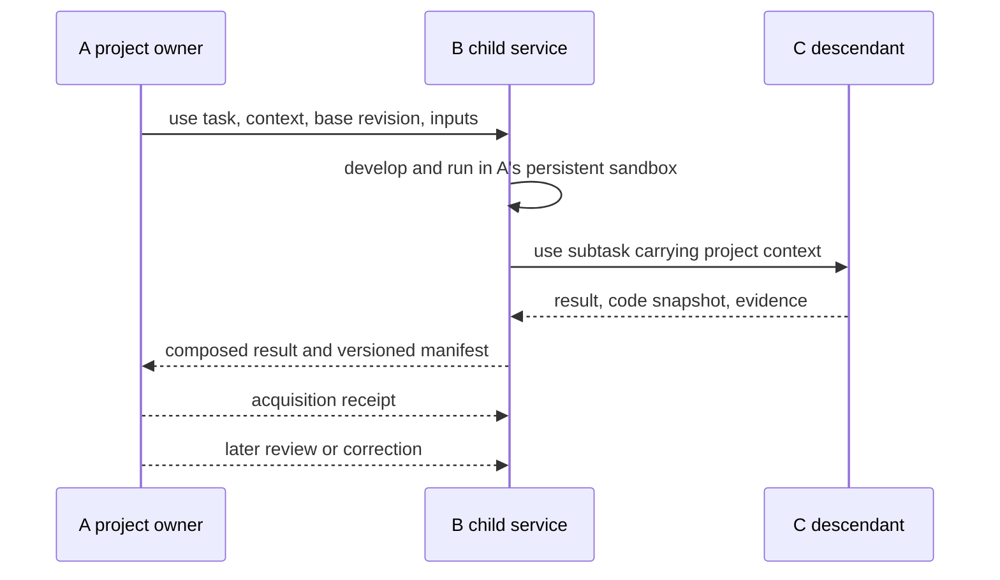

**Parent, child, persistent sandbox and modes**

This page defines the 2.0 operational model. The current implementation approximates it with local per-parent worktrees; the differences are listed below.

**Execution belongs at the service node.**

If A asks B to run a simulation, B runs it in its own environment. B owns the installed solver, model versions, dependencies and compute resources. The result is an executed task with evidence, not merely code handed back for A to run.

Task-specific code can remain in a persistent sandbox inside B. The sandbox belongs logically to A's project and is isolated from B's shared published state. A retains its research questions, criteria, decisions, acquired results and versioned copies/manifests of the code it used.

| Material | Operational location | Ownership and visibility |
|---|---|---|
| Published solver/model and shared criteria | B's canonical store and artifact storage | Shared under B's policy; versioned |
| Geometry, adapter or pipeline written for A | B's sandbox for A and its project | Specific to A's context; not automatically published |
| Run logs, checkpoints and pending deliveries | B's durable runtime and sandbox | Needed to execute, resume and deliver the task |
| A's scientific decisions and user review | A's project store | A's authoritative scientific project memory |
| Delivered code snapshot, result and execution manifest | A's store or storage it controls | Immutable copy of an identified sandbox revision |

The sandbox is not just a disposable cache after acknowledgment. It may remain active for the lifetime of the project. Acknowledgment permits delivery cleanup according to policy; it does not automatically authorize deleting the project's working environment.

**Identify a context rather than only a caller.**

The intended sandbox key includes child UID, parent UID and a stable project/work-context ID. Each execution has its own task/attempt identity. Two projects of A can have different criteria, dependencies and adaptations of B.

Record the child's base revision, the sandbox revision and hashes of input/code/model artifacts for every run. A later request can reuse that sandbox. If A supplies edits, it names the revision it edited; the service rejects or reconciles stale updates rather than overwriting newer work. The parent copy and child workspace must not evolve as unrelated mutable copies.

An output cell needs a stable owner/context namespace as well as unit and field. The current schema has only unit/field/value; project scope is still an implementation requirement. Preserve origin when transferring records: their meaning must not change because they were imported into another store.

**Two modes.**

| Mode | What the child can do | Where the work goes |
|---|---|---|
| `use` | Run existing capabilities; create code, adapters, variants and tests for this project | Persistent project sandbox in the child; scientific memory and delivered snapshots in the parent |
| `research` | Develop and validate a contribution to the child | Research workspace in the child; canonical state after reconciliation |

Both modes can write and execute code. `use` does not publish that code to other parents. `research` requires a child-issued grant and does not bypass validation. A caller permitted to research may still choose use.

A useful adapter can be proposed for shared research. Preserve its origin and tests; obtain the required research authority; validate it beyond the original project; publish only after reconciliation. The child's own authorized researcher can also initiate that adoption. Existing parent snapshots remain valid historical evidence.

**Recursive execution.**

If A uses B and B uses C, task-specific work remains in the context of A's project. Each executor can retain its operational workspace, but neither B nor C silently acquires the project's changes as shared knowledge. Immediate caller, project owner and executor are separate identities. Research authority does not propagate automatically through this chain.

**Current implementation boundary.**

Today the sandbox approximation is `.whitesnake/worktrees/<parent-id>` on `parent/<parent-id>`, inside the child repository. It is persistent and executes there, but there is no project key, mode field, grant check, task scheduler or controlled snapshot delivery of all generated code to the parent.

The parent currently stores an answer artifact, evidence and typed references. The child's work remains on its branch. A worktree is not a security isolation boundary, and manual `branch merge` can publish its contents without knowing whether they came from use or research. Follow [the local guide](local-network.md) for actual commands and [the planned remote contract](network-and-permissions.md) for implementation requirements.

